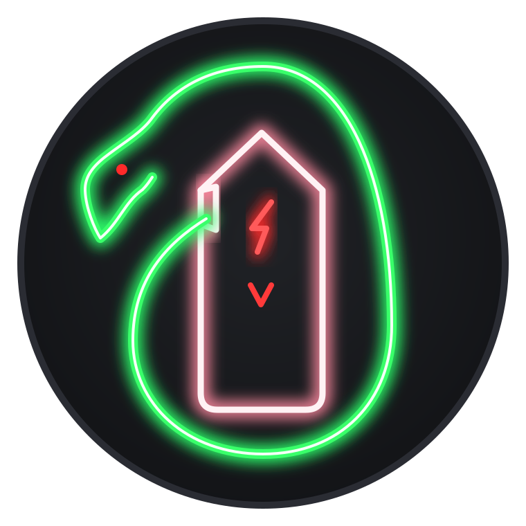
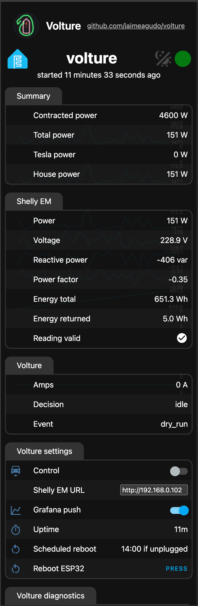
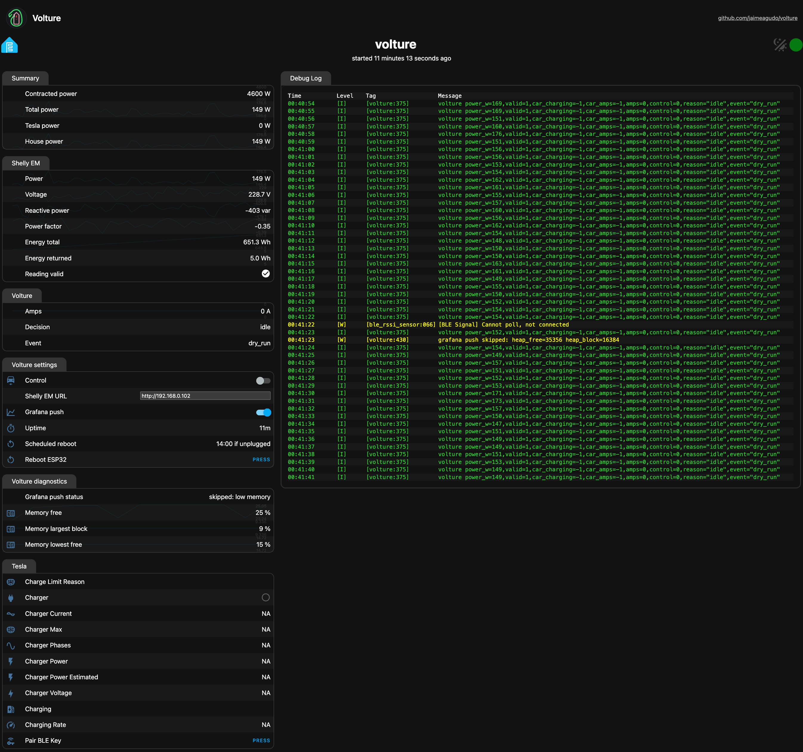

# Volture



**Charge a Tesla at home scavenging every unused Amp without ever tripping the house's contracted power limit.**

* Works 100% locally
* No internet required
* No Home-assistant
* Tesla is the master, Vulture takes the back seat

## Required Hardware

* [Shelly EM](https://www.amazon.es/-/en/Shelly-Consumption-Monitoring-History-Compatible/dp/B0BL7VC2H7?tag=fatpitches-21)
* [ESP32](https://link.amazon/B08bj02ET)


| Phone                               | Desktop                                |
| ----------------------------------- | -------------------------------------- |
|  |  |

## TL;DR

The ESP32 Watches the Shelly EM every second and decides how many amps the car may use right now, and tells the car over Bluetooth Low Energy (BLE). When any appliance turns on, the car slows down if it might trigger the limitter; when it turns off, the car speeds up again.

## Installation

You need: an ESP32 (classic, 4 MB flash), a Shelly EM Gen1 with its clamp, a Tesla, a 2.4 GHz Wi-Fi, a computer with a USB port for the first flash.

Both devices communicate via Wi-fi

* Clamp the Shelly EM to measure the current draw where appropiate (mind `shelly_includes_tesla`)
* Place the ESP32 as close as possible to the car (since it communicates through Bluetooth)

## Software

1. `git clone https://github.com/jaimeagudo/volture.git && cd volture && uv sync` ([uv](https://docs.astral.sh/uv/))
2. `cp secrets.example.yaml secrets.yaml` and fill it in: Wi-Fi, web login, the car's VIN and Bluetooth MAC ([step 4](#4-fill-in-the-secrets), [step 6](#6-find-the-cars-bluetooth-mac-address)).
3. Plug the ESP32 in over USB: `uv run esphome run esp32.yaml --device /dev/cu.usbserial-0001` ([step 5](#5-flash-the-esp32-first-time-over-usb)).
4. In the car: open `http://volture.local`, press **Pair BLE Key** (Tesla section), tap the key card on the console ([step 7](#7-pair-the-esp32-with-the-car-in-the-car)).
5. Install the Shelly EM on the main feed, put its address in **Shelly EM URL** on the page ([step 8](#8-install-the-shelly-em)).
6. Switch **Control** on (Volture settings). Start charging from the Tesla app as usual; Volture keeps the amps under the limit.

> **Safety:** this is a load *manager*, not a protection device. It does not replace the utility's power limiter or the breakers. Every failure mode is designed to end in "charge less" or "stop charging" (see [Fail-safe](#fail-safe)).


## Status (October 2026)

| Piece                                        | State                                                                                                                                                                                                |
| -------------------------------------------- | ---------------------------------------------------------------------------------------------------------------------------------------------------------------------------------------------------- |
| Control algorithm + tests                    | Done in Python and in C++ (`esp32/controller.h`); the same 24 scenarios pass on both, plus 6 for the C++ cycle on its own; every setting in `secrets.yaml`                                           |
| Control loop running on the ESP32 itself     | Running, **observe-only by default** (switch "Control" on its web page). Settings: the `volture:` block of `secrets.yaml`; poll interval, headroom and the no-reading fail-safe editable on the page |
| Observing the ESP32 (web page, live JSON)    | Done: `http://volture.local` (see [Watching the ESP32](#watching-the-esp32)); optional push to Grafana ([Grafana](#grafana-optional))                                                                |
| Simulator (fake Shelly + fake car, web page) | Done, run end to end                                                                                                                                                                                 |
| ESP32 firmware                               | Built from `esp32.yaml`, flashed, on Wi-Fi as `volture.local`                                                                                                                                        |
| Mac → ESP32 commands (`EsphomeCar`)          | Done; ESP32 confirmed receiving "set amps" and "charging on/off"                                                                                                                                     |
| ESP32 → car                                  | Paired (2026-10-15). First real charge driven by the Mac loop with a simulated Shelly: amps ramp, every command confirmed by the car                                                                 |
| Shelly EM                                    | Installed; read by the ESP32 every second                                                                                                                                                            |

---

## How it works

```text
          main feed (230 V, single phase)
                    |
            [clamp] --> Shelly EM (Gen1) ---Wi-Fi, HTTP GET /emeter/0 every second---+
                                                                                       v
   +-----------------------------------------------------------------------------------+
   |  ESP32 running esp32.yaml (yoziru/esphome-tesla-ble firmware + esp32/*.h)          |
   |  read Shelly + car state -> controller.h (pure) -> set amps / start / stop         |
   |  web page + live JSON at http://volture.local                                     |
   +-----------------------------------------------------------------------------------+
                                  | Bluetooth Low Energy
                                  v
                               Tesla
```

| Piece                                                              | Job                                                                                                            |
| ------------------------------------------------------------------ | -------------------------------------------------------------------------------------------------------------- |
| Shelly EM Gen1 + clamp                                             | Measures the house: on the main feed (car included) or on the house circuit only, see `shelly_includes_tesla`. |
| ESP32 (Elegoo, classic ESP32-D0WD-V3, 4 MB flash, CP2102 USB chip) | Runs everything: reads the Shelly, decides the amps (`esp32/controller.h`), speaks Tesla's BLE protocol.       |
| `volture/` (Python)                                                | The same algorithm in Python, for tests and the simulator on a computer. Not needed to run.                    |
| Simulator                                                          | Fake Shelly and fake car, to test everything without hardware.                                                 |

**Design rule:** `controller.py`, `confirm.py` and their C++ copy `esp32/controller.h` are pure: (time, reading, car state) in, command out. No network, no clock. Everything that touches the outside world sits behind small adapters (`car.py`, `read_shelly`), so the algorithm is tested deterministically and hardware can be swapped without touching it.

---

## Control algorithm

Runs every `poll_s` with the Shelly reading (`power`, `voltage`, `is_valid`). The numbers below are the defaults; **every one is a setting in the `volture:` block of `secrets.yaml`**, so another installation only needs that file edited. Ceiling = `contracted_power_w` − `headroom_w` (default 0, so 4,600 W; the examples below use a 230 W headroom: **4,370 W**). V is the voltage the Shelly measures (`fallback_voltage_v`, 230 V, if it reports none within 180–260 V).

| Situation                                                                                 | Action                                                                                                                              |
| ----------------------------------------------------------------------------------------- | ----------------------------------------------------------------------------------------------------------------------------------- |
| Charging and power > 4,370 W                                                              | Drop ⌈(P − 4,370) / V⌉ A at once, minimum `min_amps` (5)                                                                            |
| Already at 5 A and power > 4,600 W                                                        | Stop charging                                                                                                                       |
| Charging and power + `ramp_up_step_amps` × V ≤ 4,370 W                                    | Raise `ramp_up_step_amps` (1) A, at most every `ramp_up_every_s` (15 s), up to the amps cap                                         |
| Always, whatever the Shelly says                                                          | **Amps cap** = the lower of `max_amps` (32) and ⌊4,600 / V⌋ (**20 A** at 230 V): the car alone never exceeds the contracted power   |
| Otherwise while charging                                                                  | Hold                                                                                                                                |
| Stopped **by Volture** and house + 5 A × V fits under 4,370 W for `resume_after_s` (60 s) | Restart at 5 A, unless unplugged or at its battery charge limit                                                                     |
| Stopped by anyone else, or never started                                                  | Nothing: **Volture never starts a charge**                                                                                          |
| Believed stopped but power > 4,600 W                                                      | Send "stop" (at most every 15 s): the car may be charging without us                                                                |
| Shelly unreachable or `is_valid: false`                                                   | Nothing: the car carries on as it is (default). With `stop_without_reading`: drop to 5 A; after `stop_after_invalid_s` (30 s), stop |


**You start and stop; Volture sets the amps.** Charging is always started by you: from the Tesla app, or by the car's own schedule. Volture listens to the car's reported state through the ESP32 (charging on/off, amps, cable connected, battery % and charge limit %). A change it did not ask for came from outside, and:

| Outside change                                                        | What Volture does                                                              |
| --------------------------------------------------------------------- | ------------------------------------------------------------------------------ |
| Charging started (app, schedule), or amps changed in the app          | Takes over: raises the amps to everything that fits under the contracted power |
| Charging stopped (app, schedule, or the car reached its charge limit) | Stays stopped                                                                  |

The house's contracted power wins over the app: a 32 A charge started from the app is cut to what fits under 4,600 W.

When Volture restarts a charge it stopped itself, it skips it while the car is unplugged or its battery is at or above its charge limit; the car would refuse anyway.

- **Confirming commands:** after each command Volture waits `confirm_timeout_s` (15 s) for the car to report it. If not, it re-sends, up to `confirm_max_attempts` (3) sends in total; after that it adopts what the car reports.
- **Logged only:** the firmware's status text (`charging`: Charging, Complete, Disconnected…) and `last_command`. Their wording may change between firmware releases, so decisions use the structured values.

### Fail-safe

- **No trustworthy reading → Volture sends nothing** (default): a faulty or unreachable Shelly never stops or slows a charge; the car carries on as it is. Switch **Stop without Shelly** on (page, or `stop_without_reading` in `secrets.yaml`) to drop to the minimum amps instead, then stop after **Stop after no reading** (`stop_after_invalid_s`).
- **A failed or unconfirmed command is logged and re-sent; the loop never stops reading power.** A command gives up after `car_command_timeout_s` (10 s), and the ESP32 connection is kept alive in the background.
- **A stop from the Tesla app is permanent** until you start charging again (app or schedule).

---

## Repository layout

```text
volture/
├── esp32.yaml            # ESP32 firmware config (pulls yoziru/esphome-tesla-ble, pinned release)
├── secrets.example.yaml  # Template for secrets.yaml (gitignored), shared by firmware and Python
├── volture/           # What runs for real
│   ├── controller.py     # Pure control logic + its settings (Config)
│   ├── confirm.py        # Pure logic: did the car obey the last command?
│   ├── car.py            # EsphomeCar: the real car through the ESP32
│   ├── main.py           # Loop: read Shelly -> confirm -> decide -> command car
│   ├── pair.py           # One-off: pair the ESP32's key with the car
│   └── secrets.py        # Reads secrets.yaml (secrets + the volture: settings block)
├── simulator/            # Testing without hardware, never needed for real
│   ├── model.py          # Model 3 + house model
│   ├── server.py         # Fake Shelly Gen1 + fake car + control page (http://localhost:8081/)
│   └── car.py            # SimHttpCar: the simulated car, same interface as EsphomeCar
├── esp32/controller.h    # C++ port of controller.py + confirm.py + main.py's cycle (Loop), standard library only
├── esp32/device.h        # ESP32 adapters: read the car's entities, parse the Shelly reply, send commands, Grafana lines
├── esp32/grafana_ca.pem  # Grafana Cloud's root certificate (DigiCert Global Root G2), the only one the ESP32 trusts
├── tests/
│   ├── test_controller.py  # Every scenario, run against Python and against the C++ port
│   ├── test_loop.py        # The C++ control cycle driving the simulated car, as on the ESP32
│   ├── conftest.py         # The two backends; compiles the C++ test driver into .tmp/
│   └── cpp/controller_cli.cpp  # Test driver: controller.h behind a stdin/stdout line protocol
└── pyproject.toml
```

---

## Setup guide (from zero, macOS)

Commands go in the **Terminal** app (`Cmd + Space`, type "Terminal", Enter). Copy each block and press Enter.

**You do not need to install ESP-IDF or the ESP-IDF Installation Manager.** ESPHome downloads the whole ESP32 toolchain by itself on the first build.

### 1. Install the tools

```bash
/bin/bash -c "$(curl -fsSL https://raw.githubusercontent.com/Homebrew/install/HEAD/install.sh)"   # Homebrew
brew install git uv
```

`uv` installs Python and every dependency, ESPHome included.

### 2. Get the code and run the tests

```bash
git clone https://github.com/jaimeagudo/volture.git ~/github/volture
cd ~/github/volture
uv sync
uv run pytest -v
```

Every scenario runs twice: `[python]` and `[cpp]`. All must pass. Python 3.12–3.14 works. The `[cpp]` runs need a C++17 compiler (`xcode-select --install` on macOS); without one they are skipped.

**Changing the algorithm:** change `volture/controller.py` (or `confirm.py`) **and** `esp32/controller.h` the same way. If they differ, the `[cpp]` or `[python]` variant of some test fails.

### 3. Try the simulator (no hardware)

Terminal 1, the fake Shelly and car:
```bash
uv run python -m simulator.server
```

Terminal 2, the controller with the simulated Shelly and car:
```bash
uv run python -m volture.main --sim-shelly --sim-car
```

Nothing happens until you start charging: on the page, **Start charging** (the Tesla app's button). Volture then raises the amps 1 A every 15 s up to what fits.

Each piece is simulated independently; no flag means real hardware:

| Command                               | Shelly                         | Car                  |
| ------------------------------------- | ------------------------------ | -------------------- |
| `volture.main`                        | real (`shelly_url`)            | real (via the ESP32) |
| `volture.main --sim-shelly`           | simulator (you type the power) | real                 |
| `volture.main --sim-car`              | real                           | simulator            |
| `volture.main --sim-shelly --sim-car` | simulator                      | simulator            |

The simulator is at `http://localhost:8081` by default; `--sim-url` points elsewhere (e.g. `simulator.server --port 8091` + `--sim-url http://localhost:8091`).

Open **http://localhost:8081/** (from a phone: `http://<your-Mac's-IP>:8081/`, Mac IP: `ipconfig getifaddr en0`). Two sections:
- **Shelly (house meter):** house power, presets, voltage, `is_valid`, `online`, and the exact `/emeter/0` JSON volture reads.
- **Simulated car:** its state; start or stop charging as if from the Tesla app (volture must follow it); *plugged in*; battery % and charge limit % (the car refuses or stops charging at its limit); untick *reachable* to make the car silently ignore volture's commands and watch the re-sends in the controller log.

The same controls with `curl`:

```bash
curl -X POST "localhost:8081/_sim/base?w=3500"          # house power 3500 W
curl -X POST "localhost:8081/_sim/shelly?voltage=215"   # measured voltage
curl -X POST "localhost:8081/_sim/shelly?valid=0"       # Shelly reports invalid readings
curl -X POST "localhost:8081/_sim/shelly?online=0"      # Shelly stops answering (HTTP 503)
curl -X POST "localhost:8081/_sim/car_link?reachable=0" # car ignores volture
curl -X POST "localhost:8081/_sim/car_link?plugged=0"   # cable unplugged
curl -X POST "localhost:8081/_sim/car_link?battery=80&limit=80"  # battery at its charge limit
curl -X POST "localhost:8081/_sim/car?force=1" -d '{"charging": true, "amps": 32}'  # Tesla app starts 32 A
```

Stop any program with `Ctrl + C`.

#### Be the Shelly while driving the real car

Before the Shelly is installed, you can debug with the **real ESP32 and car**: run `simulator.server`, then `volture.main --sim-shelly`, plug in and start charging from the Tesla app. Type only the **house** power on the page: Volture copies the real car's state into the page's simulated car, so the fake reading is house + real car (amps × V), as a real clamp would measure. The page's car section then shows the real car; do not use its buttons in this mode.

### 4. Fill in the secrets

```bash
cp secrets.example.yaml secrets.yaml && open -e secrets.yaml
```

| Key                            | What it is                                                                                                                                                                                                                                        |
| ------------------------------ | ------------------------------------------------------------------------------------------------------------------------------------------------------------------------------------------------------------------------------------------------- |
| `wifi_ssid`, `wifi_password`   | Your Wi-Fi. It must offer **2.4 GHz**; the ESP32 cannot use 5 GHz.                                                                                                                                                                                |
| `wifi2_ssid`, `wifi2_password` | A second Wi-Fi (e.g. office and garage). The ESP32 joins whichever is in range. Both are required.                                                                                                                                                |
| `web_user`, `web_password`     | Login of the ESP32's web page.                                                                                                                                                                                                                    |
| `wifi_hotspot_password`        | 8+ characters. The ESP32 opens its own Wi-Fi with it if it cannot join yours.                                                                                                                                                                     |
| `api_encryption_key`           | Encrypts Mac ↔ ESP32 traffic. Generate it with the command in the template.                                                                                                                                                                       |
| `tesla_vin`                    | The car's VIN (17 characters, in the Tesla app).                                                                                                                                                                                                  |
| `ble_mac_address`              | The car's Bluetooth **MAC address**, `AA:BB:CC:DD:EE:FF` (digits 0–9 and letters A–F only, so `0` is zero, never the letter `O`). See step 6.                                                                                                     |
| `shelly_includes_tesla`        | **Crucial for the limit.** `true`: the clamp is on the main feed and measures the car too. `false`: the Shelly is on the house circuit only; the ESP32 adds the car's draw (amps × Shelly voltage) before deciding. Shown under Volture settings. |
| `scheduled_reboot_hour`        | Local hour (0–23) of the ESP32's daily reboot, skipped while the car is plugged in; `-1`: never. Default 14.                                                                                                                                      |
| `shelly_url`                   | The real Shelly: `http://SHELLY_IP`. Ignored with `--sim-shelly`.                                                                                                                                                                                 |
| `volture:` block               | Every setting: `esphome_host`, the power limits, amps, steps and timings. Each line is commented in the template; a missing line keeps its default; a typo or impossible value stops volture at startup with a clear message.                     |

`secrets.yaml` is gitignored: it never reaches GitHub.

### 5. Flash the ESP32 (first time, over USB)

1. Plug the ESP32 in with a **data** USB cable (many cables only charge).
2. Check the Mac sees it:
   ```bash
   ls /dev/cu.usbserial*
   ```
   Expect `/dev/cu.usbserial-0001`. Nothing? Try another cable or port, then install Silicon Labs' **CP210x** driver.
3. Build and flash (the first build downloads the toolchain and takes a few minutes):
   ```bash
   uv run esphome run esp32.yaml --device /dev/cu.usbserial-0001
   ```
   It ends by streaming the ESP32 log. `wifi: Connected` means it is on your network. `Ctrl + C` to leave.

Later updates go over Wi-Fi: `uv run esphome run esp32.yaml --device volture.local`.

### 6. Find the car's Bluetooth MAC address

The car constantly advertises a Bluetooth name derived from the VIN: `S` + 16 hex characters + `C`. You need the **MAC address** of that advertisement, not the name.

- **Android (easiest):** install **nRF Connect**, scan next to the car, find the 18-character `S…C` name, copy the MAC shown under it.
- **No Android** (iPhones hide MAC addresses): in `esp32.yaml`, uncomment the `tesla_ble_listener` block, flash, take the ESP32 next to the car and watch the log for `Found Tesla vehicle | Name: … | MAC: …`. Put the MAC in `secrets.yaml`, comment the block again and flash again.

### 7. Pair the ESP32 with the car (in the car)

1. Sit in the car with the ESP32 powered and within Bluetooth range, and your phone on the same Wi-Fi.
2. Open `http://volture.local` and press **Pair BLE Key** (Tesla section).
3. **Immediately** tap the NFC key card on the centre console and confirm the prompt on the car's screen.
4. Check *Controls → Locks*: a new key ("Unknown device") appears. Rename it to "volture" if you like.

The key is paired with the **`CHARGING_MANAGER`** role (set in `esp32.yaml`): it can start/stop charging and set amps, but cannot unlock or drive. Changing the role requires pairing again.

### 8. Install the Shelly EM

1. Power the Shelly, join its Wi-Fi `shellyem-XXXXXXXXXXXX`, open `http://192.168.33.1/` and enter your Wi-Fi.
2. Reserve a **fixed IP** for it in your router; update its firmware.
3. Put the clamp around **one single conductor** of the main feed (not phase and neutral together: they cancel out). **If you are not comfortable working in the electrical panel, have an electrician do it.**
4. Check: `curl http://SHELLY_IP/emeter/0` returns `power`, `voltage`, `is_valid`. Switch on a known load (a heater): `power` must rise by that amount and be **positive**. Negative means the clamp is backwards.

### 9. Run for real

On `http://volture.local`, put `http://SHELLY_IP` in **Shelly EM URL** and check the **Shelly EM** section shows live values. Then switch **Control** on (Volture settings). Start charging as usual (Tesla app or the car's schedule); Volture takes it from there. The computer is no longer needed.

### Watching the ESP32

Open **http://volture.local** (phone or Mac, on your Wi-Fi), user `web_user`, password `web_password` from `secrets.yaml`. The page shows every value live and lets you change two things:

One section per data source, so every value says where it comes from. Every car control and every other car reading is hidden from the page and the API: the car is controlled from the Tesla app, and fewer entities keep the page from running the ESP32 out of memory.

| Section                 | Entity                                                                                     | Meaning                                                                                                                                        |
| ----------------------- | ------------------------------------------------------------------------------------------ | ---------------------------------------------------------------------------------------------------------------------------------------------- |
| **Summary**             | Contracted power                                                                           | The limit the ESP32's loop never exceeds (its built-in setting)                                                                                |
|                         | Tesla power                                                                                | = Tesla Charger Current × Shelly EM Voltage; 0 when the car is unplugged or out of Bluetooth range                                             |
|                         | House power                                                                                | Everything but the car: Shelly EM Power − Tesla power if `shelly_includes_tesla` is true, else Shelly EM Power                                 |
|                         | Total power                                                                                | House power + Tesla power (= Shelly EM Power when the Shelly includes the car)                                                                 |
| **Shelly EM**           | Power, Voltage, Reactive power, Power factor, Energy total, Energy returned, Reading valid | Every value of the Shelly's `/emeter/0` reply, read every second (empty: no reply)                                                             |
| **Volture**             | Amps                                                                                       | Amps the loop has decided (0: stopped)                                                                                                         |
|                         | Decision                                                                                   | Why, e.g. `ramp`, `no_room`, `amps_cap`, `over_limit_drop`, `no_reading_stop`, `idle`; plus what it sent (or *would send* when control is off) |
|                         | Event                                                                                      | What the car did with the last command: `confirmed`, `waiting`, `resend`, `outside_change`, `dry_run`…                                         |
| **Volture settings**    | Control (switch)                                                                           | Off (default): observe only, nothing sent to the car. On: the ESP32 drives the car. Kept across reboots                                        |
|                         | Shelly EM URL (text)                                                                       | Where the ESP32 reads power: the real Shelly EM (`http://<Shelly IP>`), or the Mac's fake one (`http://<Mac IP>:8081`, not `localhost`)        |
|                         | Poll interval (s)                                                                          | How often the Shelly is read. First boot: `poll_s`; then kept across reboots                                                                   |
|                         | Headroom (W)                                                                               | Margin kept below the contracted power. First boot: `headroom_w` (default 0)                                                                   |
|                         | Stop without Shelly (switch)                                                               | Off (default): without a Shelly reading Volture sends nothing, the car carries on. On: minimum amps, then stop                                 |
|                         | Stop after no reading (s)                                                                  | With Stop without Shelly on: how long without a reading before stopping (`stop_after_invalid_s`)                                               |
|                         | Grafana push (switch)                                                                      | Off (default): nothing goes to the internet. On: push to Grafana, if configured ([Grafana](#grafana-optional)). Kept across reboots            |
|                         | Uptime, Scheduled reboot                                                                   | Time since the last start; the daily reboot hour (`scheduled_reboot_hour`), skipped while the car is plugged in                                |
|                         | Reboot ESP32 (button)                                                                      | Reboots now (~10 s). Unlike the scheduled one it does not check the cable: a charge Volture had paused is then not resumed                     |
| **Volture diagnostics** | Grafana push status                                                                        | Result of the last push: `ok 204, … B`, `error 401`, `error: no answer`, `skipped: low memory`                                                 |
|                         | Memory free / largest block / lowest free                                                  | ESP32 memory, % of the whole                                                                                                                   |
| **Tesla**               | Charger, Charger Current, Charger Power…                                                   | The car's charging readings (names starting "Charg"), as the car reports them over Bluetooth                                                   |

The logo comes from `esp32/web_logo.js`, which embeds `volture-logo.svg` (a test fails if they differ). Renaming an entity in `esp32.yaml` resets its saved value (switches back to off, the Shelly EM URL back to `shelly_url` in `secrets.yaml`).

For tools, the same data is plain JSON: `GET http://volture.local/events` streams one JSON line per change (Server-Sent Events); `GET /sensor/Volture%20house%20power` returns one value. Every cycle the log also prints one line in InfluxDB line-protocol form (`volture power_w=4330,amps=16,reason="no_room",…`): `uv run esphome logs esp32.yaml --device volture.local`.

### Grafana (optional)

The ESP32 can push everything it sees to a free Grafana Cloud account, for charts and history on any phone. It sends one line per 5-second cycle in which something changed (always at least one a minute), batched once a minute. Off until you set it up and switch it on; switch "Grafana push" off on the web page at any time to stop all internet traffic.

**1. Get the URL and instance ID** (checked in a real account, 2026-10-15). Ignore Grafana's "Add new connection" / "How do you want to connect your Prometheus data" wizards and the **InfluxDB integration** (*Connections → InfluxDB*; it monitors an InfluxDB database server through Grafana Alloy): the ESP32 needs none of them, only the push address, instance ID and token below.
1. Create a free account at [grafana.com](https://grafana.com). It creates a *stack*, e.g. `yourname`.
2. On grafana.com click **My account** (top right). You land on the *Grafana Cloud Portal*.
3. In the left menu, under **GRAFANA CLOUD**, click your stack's name.
4. On the stack page, find the card **InfluxDB Connectivity** ("Connect using InfluxDB protocol") and click **Configure**. The page *"…-prom - InfluxDB connection details"* opens (URL: `https://grafana.com/orgs/<org>/hosted-metrics/<instance ID>/influxdb-info`). It shows:
   - **Write Endpoint**, e.g. `https://prometheus-prod-58-prod-eu-central-0.grafana.net`;
   - **Username / Instance ID**, a number, e.g. `3678527`.

**2. Create the token** on that same page:
1. Under **Password / API Token**, click **Generate now**. A *Create an API token* dialog opens.
2. *Access policy name* is filled in for you; type any **Token name** (e.g. `volture-esp32`); leave **Expiration** at *No expiry* (or pick a date, and remember to renew it); the scopes are predefined and include `metrics:write`.
3. Click **Create token** and copy it right away: it is shown only once.

**3. Put them in `secrets.yaml`**, adding `/api/v1/push/influx/write` to the Write Endpoint:
```yaml
grafana_url: "https://prometheus-prod-58-prod-eu-central-0.grafana.net/api/v1/push/influx/write"
grafana_user: "3678527"
grafana_token: "<the token>"
```

**4. Flash and switch on:**
```bash
uv run esphome run esp32.yaml --device volture.local
```
Open `http://volture.local`, switch **Grafana push** on. Within 2 minutes **Grafana push status** shows `ok 204, … B`. `error 401`: wrong instance ID or token; `error 405`: the URL lacks `/api/v1/push/influx/write`; `error: no answer`: no internet, or Grafana changed certificate authority (replace `esp32/grafana_ca.pem`).

**5. See the data:** open your Grafana (`https://<stack>.grafana.net`) → menu **Connections** → **Data sources** → on `grafanacloud-<stack>-prom` (Prometheus, marked *default*) click **Explore** → in the metric box type `volture_`. The InfluxDB lines arrive as Prometheus metrics, so they are only queryable through that Prometheus data source. Metrics (Prometheus names = `volture_` + field):

| Metric                                                                           | Meaning                                                                                                                                                                             |
| -------------------------------------------------------------------------------- | ----------------------------------------------------------------------------------------------------------------------------------------------------------------------------------- |
| `volture_house_w`, `volture_house_v`, `volture_house_a`                          | Shelly: total power, voltage, current (power / voltage)                                                                                                                             |
| `volture_shelly_valid`                                                           | 1: the reading was trustworthy                                                                                                                                                      |
| `volture_amps`                                                                   | Amps Volture decided (0: stopped)                                                                                                                                                   |
| `volture_control`                                                                | 1: "Control" on (ESP32 drives the car)                                                                                                                                              |
| `volture_car_charging`, `volture_car_amps`, `volture_car_plugged`                | What the car reports: charging, amps setting, cable                                                                                                                                 |
| `volture_car_current_a`, `volture_car_power_kw`                                  | What the car actually draws                                                                                                                                                         |
| `volture_car_battery_pct`, `volture_car_limit_pct`                               | Battery and the car's charge limit                                                                                                                                                  |
| `volture_sent_charging`, `volture_sent_amps`, `volture_sent_attempts`            | Last command sent, and sends so far of the unconfirmed one (0: none pending)                                                                                                        |
| `volture_state{reason, event, answer, status}`                                   | Labels: Volture's decision (`ramp`, `no_room`, `amps_cap`…), what happened to the command (`confirmed`, `resend`…), the car's answer to the last command, the car's charging status |
| `volture_heap_free`, `volture_heap_block`, `volture_wifi_dbm`, `volture_ble_dbm` | ESP32 health                                                                                                                                                                        |

**6. The dashboard:** `grafana/volture-dashboard.json` is a ready-made dashboard, phone-first (one panel per row):
- **Now:** house power (*No Shelly* until one is installed), current the car draws, amps Volture decided, battery.
- **Power vs contract:** house and car power, with the 4,370 W working ceiling (orange) and 4,600 W contract (red).
- **Amps:** Volture's decision, the car's setting, what the car draws, the last command sent, the house's total current; red line at the 20 A cap.
- **Volture decision**, and **Car status and answer to the last command**: timelines of the labels on `volture_state`.
- **Charging, cable, control**; **Battery** vs the car's charge limit; **ESP32 health** (memory, Wi-Fi, Bluetooth).

Import it: in your Grafana, **Dashboards** → **New** → **Import** → *Upload dashboard JSON file* → pick `grafana/volture-dashboard.json` → **Import**. It opens as *Volture* (`https://<stack>.grafana.net/d/volture/volture`). After changing it in Grafana, export it back (*Share* → *Export* → *Save to file*) over this file so the repository stays the source.

**Optional alert:** *Alerting* → *Alert rules* → *New alert rule*, query `max_over_time(volture_house_w[5m]) > 4600`, contact point your e-mail or the Grafana mobile app.

### Troubleshooting

| Symptom                                                                                           | Likely cause                                                                                                                                                                     |
| ------------------------------------------------------------------------------------------------- | -------------------------------------------------------------------------------------------------------------------------------------------------------------------------------- |
| No `/dev/cu.usbserial*`                                                                           | Charge-only cable, bad port, or missing CP210x driver                                                                                                                            |
| ESP32 log: `wifi … Auth Expired` once, then `Connected`                                           | Normal on some routers: it retries                                                                                                                                               |
| ESP32 never connects to Wi-Fi                                                                     | Wrong password, or the network is 5 GHz only                                                                                                                                     |
| `Invalid encryption key`                                                                          | `api_encryption_key` differs from the one the ESP32 was flashed with: flash again                                                                                                |
| `Timeout while resolving IP address for volture.local`                                            | The Mac has not discovered the new name yet; retry, or set `esphome_host` to the ESP32's IP                                                                                      |
| `ESP32 not connected` / `car state unavailable` all the time, though `ping volture.local` answers | Weak ESP32 Wi-Fi: small packets pass, large ones are lost (check `ping -s 1400 volture.local`). Move the ESP32 or the router closer; aim for a `WiFi Signal` above about -75 dBm |
| ESP32 log: `Command failed: … Connection lost`                                                    | Car out of Bluetooth range, asleep, or not paired yet                                                                                                                            |
| Pairing: no prompt on the car                                                                     | Wrong MAC/VIN in `secrets.yaml`, or the NFC card was not tapped right away                                                                                                       |
| Upload ends with `Finishing update failed`                                                        | Firmware built for another board; this board needs `tesla-ble-esp32-generic`                                                                                                     |
| Controller drops to 5 A then stops                                                                | Shelly unreachable or `is_valid: false` (intended fail-safe)                                                                                                                     |

---

## Decisions

1. **Shelly EM Gen1 (€37) over Gen3 (€60).** Power + `is_valid` over a plain HTTP GET is all that's needed; on-device history is irrelevant because decisions happen every few seconds. Accepted risk: Gen1 firmware is frozen at 1.14.0 (2023) and only gets fixes.
2. **The Shelly cannot replace the ESP32.** Shelly scripts can only scan BLE adverts (no GATT connection) and have ~25 KB of memory; Tesla's BLE protocol needs elliptic-curve crypto and protobuf.
3. **Everything runs on the ESP32, 24/7, no other machine and no Home Assistant** (decided 2026-10-15). The control algorithm is ported to C++ (`esp32/controller.h`, tested) and runs on the ESP32, observe-only until "Volture control" is switched on (decision 15); until then the Python loop on a Mac drives the car. The Python version stays for debugging on a Mac, and both implementations must pass the same test scenarios so they cannot drift.
4. **ESPHome native API for the Mac; a password-protected web page for people.** The native API (Mac ↔ ESP32) is encrypted with a key. The web page (decision 16) uses a password with *digest* login, so the password itself never travels; the page itself is plain HTTP, so its content can be read on the Wi-Fi, and it can operate the car's charging controls. Firmware updates through the page are disabled (`ota: false`): only `esphome run` (encrypted) can flash. Accepted for a home LAN; do not expose `volture.local` to the internet.
5. **Firmware from `esp32.yaml`, not a local clone.** `esp32.yaml` pulls the yoziru firmware from GitHub at a pinned release. No clone, no Makefile; upgrading is changing `tesla_ble_ref` (and the matching `esphome` version in `pyproject.toml`).
6. **Least-privileged car key** (`CHARGING_MANAGER`): a leaked key can only affect charging.
7. **One file to configure everything** (`secrets.yaml`): secrets shared by firmware and Python, plus every algorithm setting in its `volture:` block.
8. **Board:** classic ESP32 → `tesla-ble-esp32-generic`. Alternatives (M5Stack NanoC6, Seeed XIAO ESP32-C6) only matter if Bluetooth range in the garage turns out poor (external antenna).
9. **Restart threshold:** restart only if *house + 5 A* fits under the ceiling (house < 3,220 W); restarting below 3,910 W, as first proposed, would exceed the contracted power at 5 A.
10. **Proportional drop:** one step of ⌈(P − 4,370) / V⌉ A corrects a big spike at once instead of 1 A per cycle.
11. **Confirm with the car's state, not `last_command` text:** the switch/amps states are structured; `last_command` is firmware prose that may change between releases.
12. **No time-based charging, ever** (decided 2026-10-15). Volture has no schedule, off-peak window or clock-based rule. The car itself or the owner (Tesla app) decide when to charge, and whether the cable is plugged in. A schedule in Volture would duplicate the car's own scheduling: a second source of truth that drifts. Volture only keeps the house under its contracted power and follows the Tesla app.
13. **Volture never starts a charge** (decided 2026-10-15). The owner starts it (Tesla app or the car's schedule); Volture then uses every amp that fits under the contracted power, whatever amps the app set. The only exception: a charge Volture itself stopped to protect the contracted power (or for lack of Shelly readings) is resumed once there is room again; otherwise one spike at night would end the whole night's charge. Which pieces are simulated is chosen per run with `--sim-shelly` / `--sim-car`, not in `secrets.yaml`.
14. **Hard amps cap from basic maths** (decided 2026-10-15). Amps never exceed the lower of `max_amps` and ⌊`contracted_power_w` / V⌋ (20 A at 4,600 W / 230 V), whatever the Shelly reports. Added after a test where a fake Shelly reading that did not include the car let Volture reach 22 A (5,060 W). Since then `--sim-shelly` with the real car adds the real car's power to the fake reading, as a real clamp would.
15. **The ESP32's loop starts observe-only** (decided 2026-10-15). Switch "Control" on its web page decides whether it drives the car; off by default, then kept across reboots. With it off the loop still reads everything and shows what it *would* send, so its decisions can be compared with the Mac's before handing over. Never run both in control at once.
16. **The ESP32 always serves its web page** (owner's requirement, 2026-10-15): live values and the JSON stream at `/events`, at `http://volture.local`. It is never removed or made optional to save memory or flash.
17. **Grafana push: optional, off by default, one switch** (decided 2026-10-15). The ESP32 sends nothing to the internet unless `grafana_url` is set **and** "Volture Grafana push" is on (web page, kept across reboots). It sends one line per 5-second cycle in which something changed (at least one a minute), batched once a minute; no summaries. Costs 0.6% flash, by trusting only Grafana Cloud's root certificate (DigiCert Global Root G2, `esp32/grafana_ca.pem`) instead of ESP-IDF's whole bundle. Network time (SNTP) is used **only** to timestamp those lines, never by the control logic. Memory is tight during a push (measured ~12.6 KB free at the lowest); watch `volture_heap_block` in Grafana. Details: [issue #12](https://github.com/jaimeagudo/volture/issues/12).

---

## To do

- Install the Shelly (steps 8–9) and run a real charge with it. Check in the log that the car's reported state confirms each command (`car confirmed …`).
- Measure how often the Shelly Gen1 refreshes `power` (`curl` every second); it bounds how short `poll_s` can be.
- Confirm the clamp model (50 A or 120 A) covers the house's peak. The installation is single-phase.
- Hand control to the ESP32 for real ("Control" on) once the real Shelly is in.
- More settings on the ESP32's page: [issue #13](https://github.com/jaimeagudo/volture/issues/13) (today: poll interval, headroom and the no-reading fail-safe; the rest comes from `secrets.yaml` at build time).
- A slow car confirmation can be mistaken for a change made in the Tesla app: [issue #14](https://github.com/jaimeagudo/volture/issues/14).
- Grafana push: run it a few days with a real account and watch `volture_heap_block` and Bluetooth drops ([issue #12](https://github.com/jaimeagudo/volture/issues/12)).

## Possible improvements

Solar-surplus mode · history and charts ([issue #12](https://github.com/jaimeagudo/volture/issues/12)) · three-phase support (Shelly 3EM) · failure notifications · external-antenna board if BLE range is poor.

---

## History

| Date       | PR    | What changed                                                                                                                                                      |
| ---------- | ----- | ----------------------------------------------------------------------------------------------------------------------------------------------------------------- |
| 2026-10-14 | #1–#2 | Python controller + simulator; ESP32 firmware config (`esp32.yaml`, yoziru/esphome-tesla-ble, `CHARGING_MANAGER` key); real car control through the ESP32         |
| 2026-10-15 | #3    | Second Wi-Fi; `shelly_url` setting; fake Shelly page; 10 s car command timeout                                                                                    |
| 2026-10-15 | #4    | `simulator/` folder; every setting in `secrets.yaml`; measured voltage; commands confirmed with the car's reported state (also an off-peak window, removed in #6) |
| 2026-10-15 | #5    | Project renamed SirWattson → Volture; the Tesla app has priority; never start an unplugged or full car                                                            |
| 2026-10-15 | #6–#7 | Time-based charging removed for good (decision 12); C++ port `esp32/controller.h`, every scenario run against Python and C++                                      |
| 2026-10-15 | #8    | Volture never starts a charge, uses every amp that fits (decision 13); `--sim-shelly` / `--sim-car` flags replace `car:`                                          |
| 2026-10-15 | #9    | Fixed `CoverState` errors and a hang at startup (aioesphomeapi 46.3.0 zeroconf listener bug, worked around)                                                       |
| 2026-10-15 | #10   | Hard 20 A cap (decision 14); fake Shelly includes the real car's load; no redundant "start"                                                                       |
| 2026-10-15 | #11   | C++ loop running on the ESP32, observe-only by default; web page with live JSON (decisions 15–16); HTTPS memory measured                                          |
| 2026-10-15 | #15   | HTTPS test removed; decisions documented; issues #12–#14 opened                                                                                                   |
| 2026-10-15 | this  | Optional Grafana push, one switch on the web page (decision 17)                                                                                                   |

## License

GPL-3.0. Copyright (C) 2026 Jaime Agudo, [github.com/jaimeagudo/volture](https://github.com/jaimeagudo/volture). See [LICENSE](LICENSE).

## Links

- [yoziru/esphome-tesla-ble](https://github.com/yoziru/esphome-tesla-ble): the ESP32 firmware this project runs
- [Shelly Gen1 API](https://shelly-api-docs.shelly.cloud/gen1/) · [Shelly EM](https://kb.shelly.cloud/knowledge-base/shelly-em)
- [aioesphomeapi](https://github.com/esphome/aioesphomeapi): Python client for the ESPHome native API
- [ESPHome native API](https://esphome.io/components/api/) · [uv](https://docs.astral.sh/uv/)

## Disclaimer

As an Amazon Associate, I earn from qualifying purchases to help offset the costs of development and maintenance of this project, the price you pay is unaffected

## FAQ

### Do I need the USB cable again to update the ESP32?

No. After the first flash over USB, every update goes over Wi-Fi, encrypted with `api_encryption_key` from `secrets.yaml`. From the repository, on the same network as the ESP32:

```bash
uv run esphome run esp32.yaml --device volture.local
```

If `volture.local` does not resolve, use the ESP32's IP address instead (`--device 192.168.x.y`; your router lists it). Updates through the web page are disabled on purpose.

You still need the cable when:

- **The new firmware cannot join your Wi-Fi** (wrong password in `secrets.yaml`, router replaced). To change the Wi-Fi password safely, add the new network as `wifi2_ssid` / `wifi2_password` and flash while the old one still works: the ESP32 then knows both.
- **`api_encryption_key` changes:** the computer and the ESP32 no longer share the key. Keep `secrets.yaml` safe and backed up.

A firmware that keeps crashing at startup does not need the cable: after 10 quick restarts in a row the ESP32 starts in a minimal safe mode that still accepts Wi-Fi updates, so you can flash a fixed version.

The car keeps charging at its current amps while the ESP32 restarts after an update (about 10 seconds).

# Tips: how does the hostname volture.local resolves?

The IP address comes from your router (DHCP) and can change. The name works anyway thanks to **mDNS** (multicast DNS, Apple's "Bonjour"): the ESP32 announces "I am volture, at this IP" on the local network, with no DNS server involved.

- **Macs and iPhones:** `.local` names work.
- **Android:** recent Chrome versions usually work; some apps and older phones do not.
- **Only on the ESP32's own network:** mDNS does not cross separate networks (a guest Wi-Fi, two Wi-Fi networks the router keeps apart) or VPNs.

**Recommended:** reserve the ESP32's address in your router ("DHCP reservation" or "static lease"). The router then always gives it the same IP, which works everywhere `.local` does not. This is better than a fixed IP set on the ESP32 itself, which the router could hand to another device and which breaks if you change routers.

Do the same for the **Shelly EM**: the ESP32 reads it by IP address every second (**Shelly EM URL** on the page), so that address must not change.
