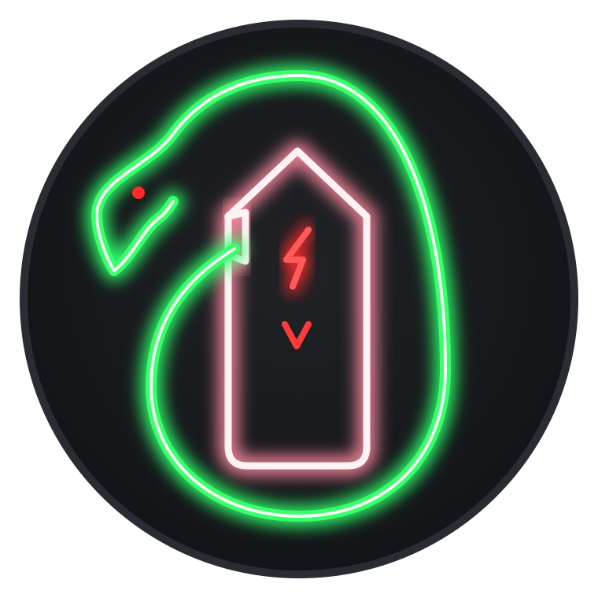
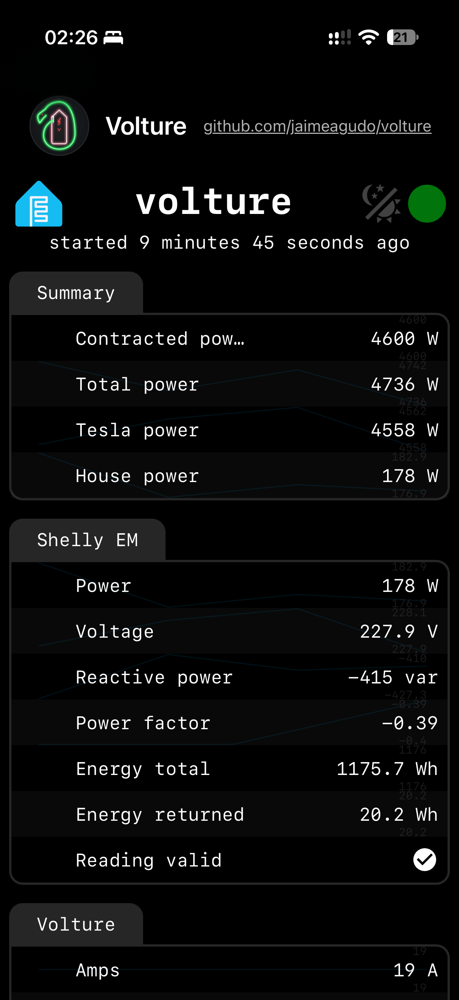
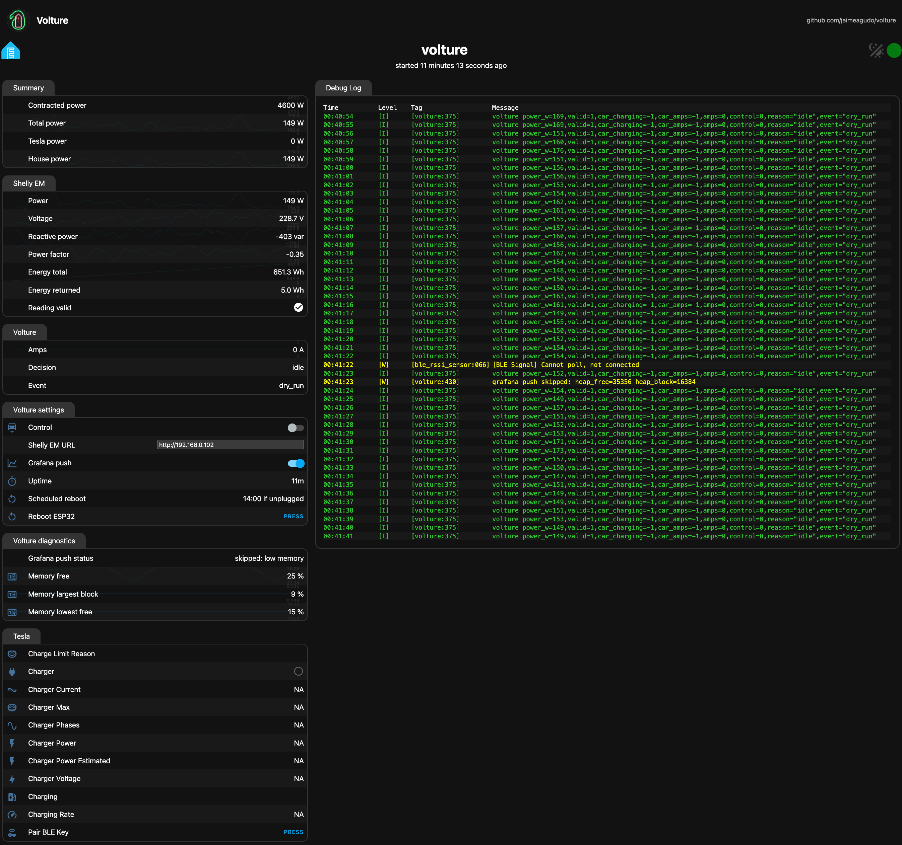
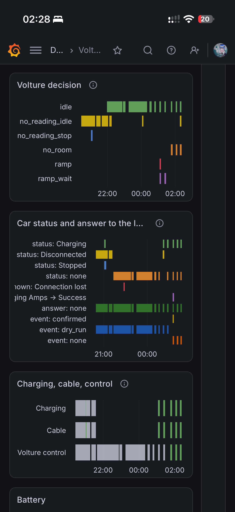

Detect language
English
Spanish
French
Spanish
English
Arabic
5,000
# Volture

**Carga tu Tesla en casa aprovechando cada amperio disponible, sin superar nunca el límite de potencia contratada de tu vivienda.**

* Funciona 100 % de forma local.
* No requiere conexión a internet.
* No necesita Home Assistant.
* El Tesla tiene el control principal; Volture actúa en segundo plano.
* Solo lee la programación de carga de tu vehículo para garantizar que esta se respete siempre.

## Hardware necesario

* [Shelly EM](https://www.amazon.es/-/en/Shelly-Consumption-Monitoring-History-Compatible/dp/B0BL7VC2H7?tag=fatpitches-21)
* [ESP32](https://link.amazon/B08bj02ET)

| Móvil                                      | Escritorio                                    | Grafana                                    |
| ------------------------------------------ | --------------------------------------------- | ------------------------------------------ |
|  |  |  |

## Resumen rápido

El ESP32 monitoriza el Shelly EM segundo a segundo, determina cuántos amperios puede consumir el vehículo en cada momento y se lo comunica al coche mediante Bluetooth Low Energy (BLE). Si se enciende algún electrodoméstico, la carga del vehículo se reduce para evitar superar el límite de potencia; cuando el electrodoméstico se apaga, la velocidad de carga aumenta de nuevo.

## Instalación

Necesitas: un ESP32 (versión clásica, con 4 MB de memoria flash), un Shelly EM Gen1 con su pinza amperimétrica, un Tesla, una red Wi-Fi de 2,4 GHz y un ordenador con puerto USB para realizar la carga inicial del firmware. Ambos dispositivos se comunican a través de Wi-Fi.

* Coloca la pinza del Shelly EM en el punto adecuado para medir el consumo de corriente (ten en cuenta `shelly_includes_tesla`).
* Sitúa el ESP32 lo más cerca posible del vehículo (ya que la comunicación se realiza mediante Bluetooth).

## Software

1. `git clone https://github.com/jaimeagudo/volture.git && cd volture && uv sync` ([uv](https://docs.astral.sh/uv/))
2. `cp secrets.example.yaml secrets.yaml` y completa los datos: Wi-Fi, credenciales de acceso web y el VIN del vehículo ([paso 4](#4-fill-in-the-secrets)).
3. Conecta el ESP32 mediante USB: `uv run esphome run esp32.yaml --device /dev/cu.usbserial-0001` ([paso 5](#5-flash-the-esp32-first-time-over-usb)).
4. En el vehículo: accede a `http://volture.local`, pulsa **Pair BLE Key** (sección Tesla) y acerca la tarjeta llave a la consola central ([paso 6](#6-pair-the-esp32-with-the-car-in-the-car)).
5. Instala el Shelly EM en la línea de alimentación principal e introduce su dirección en el campo **Shelly EM URL** de la página web ([paso 7](#7-install-the-shelly-em)).
6. Activa la opción **Control** (en la configuración de Volture). Inicia la carga desde la aplicación de Tesla como de costumbre; Volture mantendrá el amperaje por debajo del límite establecido.

> **Seguridad:** este dispositivo es un *gestor* de carga, no un dispositivo de protección. No sustituye al limitador de potencia de la compañía eléctrica ni a los interruptores automáticos (magnetotérmicos). Ante cualquier fallo, el sistema está diseñado para reducir la carga o detenerla por completo (consulta la sección [Fail-safe](#fail-safe)).

## Estado (octubre de 2026)

| Componente                                   | Estado                                                                                                                                                                                                                                                |
| -------------------------------------------- | ----------------------------------------------------------------------------------------------------------------------------------------------------------------------------------------------------------------------------------------------------- |
| Algoritmo de control + pruebas              | Implementado en Python y C++ (`esp32/controller.h`); ambos superan los mismos 24 escenarios, con 6 adicionales específicos para la versión en C++. Todos los parámetros se configuran en `secrets.yaml`. |
| Bucle de control ejecutándose en el ESP32   | En funcionamiento; **por defecto, solo en modo de observación** (se puede activar el control desde la interfaz web). Configuración: bloque `volture:` en `secrets.yaml`. Desde la interfaz web se pueden ajustar: intervalo de consulta al Shelly, margen de seguridad (*headroom*), mecanismo de seguridad ante falta de lecturas, hora de reinicio y exclusión de datos de memoria para Grafana. |
| Monitorización del ESP32 (interfaz web, JSON en tiempo real) | Disponible en `http://volture.local` (ver [Monitorización del ESP32](#watching-the-esp32)); incluye opción de envío de datos a Grafana ([Grafana](#grafana-optional)).                                                                                                                 |
| Simulador (Shelly y vehículo simulados, interfaz web) | Implementado; permite realizar pruebas integrales (*end-to-end*). |
| Firmware del ESP32                          | Generado a partir de `esp32.yaml` y cargado en el dispositivo; accesible vía Wi-Fi como `volture.local`.                                                                                                                                                          |
| Comandos desde Mac al ESP32 (`EsphomeCar`)  | Implementado; se ha confirmado que el ESP32 recibe correctamente los comandos para ajustar el amperaje (*set amps*) y activar/desactivar la carga (*charging on/off*).
Send feedback
Use the arrows to see the full translation.
Translation results available